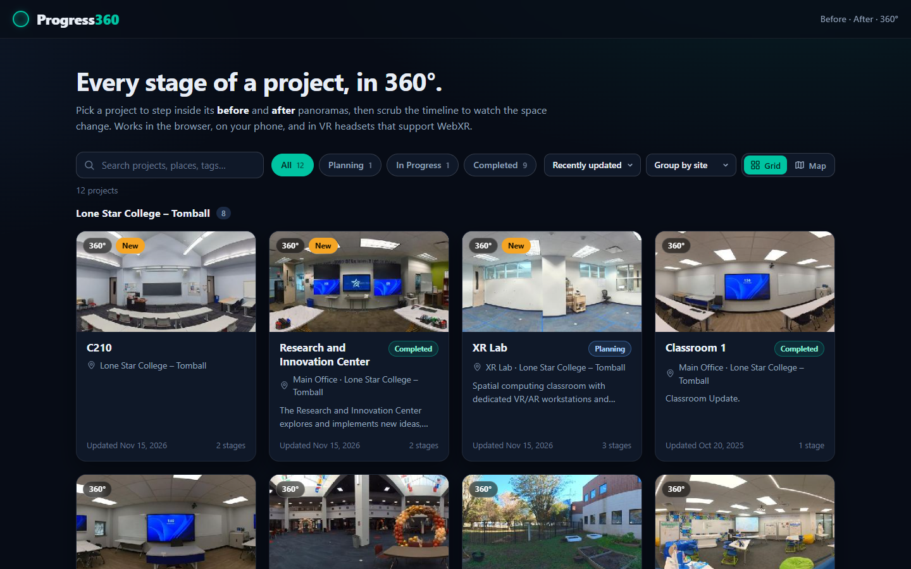
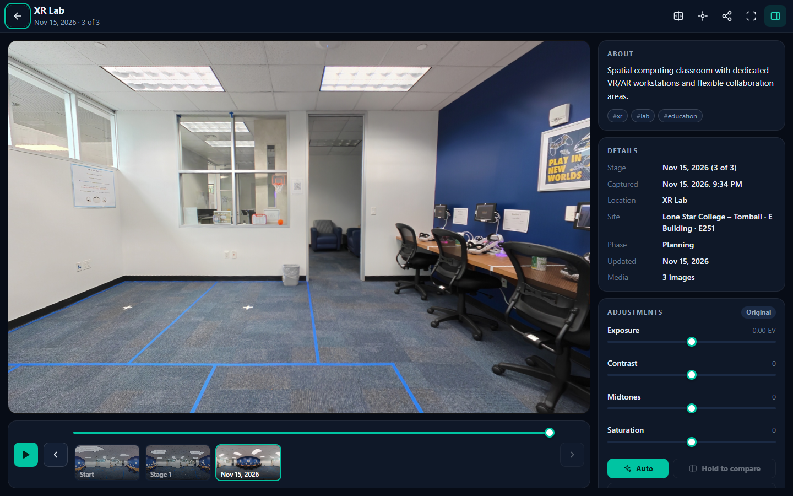

# Progress360

Progress360 is a static website for showing how a space changes over time. Each project is a set of 360° panoramas (photos or videos), from **before** through every stage to **after**. Visitors open a project and look around in 360°. They can cross-fade between stages on a timeline, compare two stages side by side, and view it in a VR headset through WebXR.

There is no build step and no backend. It's plain HTML, CSS and ES modules. [three.js](https://threejs.org/) and [Leaflet](https://leafletjs.com/) are bundled in `vendor/`, so the site needs no CDN.

| Gallery | Viewer |
|---|---|
|  |  |

## Features

**Gallery**
- Project cards with a small panning animation on hover, search, phase filters, and a **New** badge for projects updated in the last 30 days.
- **Sort** by recently updated, name or the original order. **Group** by site or by phase.
- **Map view**: projects placed on an OpenStreetMap map, using `meta.gps` or the GPS stored in the photos. Projects whose site is `"Private"` stay off the map unless they have an explicit `meta.gps`.

**Viewer**
- **360° viewer** for equirectangular JPEGs and MP4 videos. Drag to look around; scroll or pinch to zoom.
- **Timeline** that cross-fades smoothly between stages, a filmstrip, and **Play** to loop through every stage.
- **Split view** (`S`): two stages side by side with a draggable divider, for exact before/after comparisons.
- **Hotspots**: points in the panorama with a note, and optionally a link to another project.
- **Per-stage alignment**, so when the camera was turned differently between visits, stages still line up when they cross-fade.
- **Start view** per project: the direction a visitor first looks.
- **Share links** that open the same stage and view direction, and an **embed mode** (`?embed=1`) for iframes.
- **Faithful colour.** Images display exactly as captured. Optional exposure, contrast, midtone and saturation adjustments apply to every stage equally.
- **Fast on phones**: shows the thumbnail straight away, then loads a 4096 px copy (`-4k.jpg`) on phones and smaller GPUs instead of the full 8K image.
- **Details panel** with the description, tags, capture date and GPS from EXIF, and site info.
- **VR mode** in WebXR-capable browsers.

**Editing and upkeep**
- **Editor mode** (`?edit`): set alignment, the start view and hotspots by pointing and clicking, then copy the JSON into `projects.json`.
- **Sync and validation script** that keeps `projects.json` in step with the folders and catches mistakes.
- **Installable (PWA)** with an offline-capable app shell, plus a service worker that caches panoramas.
- **Smoke tests** in headless Chrome, and a GitHub Actions workflow that runs them and can deploy to GitHub Pages.

## Quick start

Serve the folder over HTTP. Opening `index.html` as a file won't work, because ES modules and `fetch` need a server.

```bash
npm run serve            # http://localhost:8080/  (no install needed)
# or VS Code "Live Server" (port 5501, see .vscode/settings.json), or any static server
```

Panorama videos are stored with **Git LFS**. After cloning, run `git lfs install && git lfs pull`, otherwise the `.mp4` files are only small pointer files.

## Adding a project (short version)

1. Create `assets/<folder>/` and drop in the panoramas, named by date (`20261115_anything.jpg`) or by number (`000-<slug>.jpg`, `001-<slug>.jpg`, …).
2. Run `npm run sync` (or `node tools/sync-projects.mjs`). It adds new folders and dated files to [`assets/projects.json`](assets/projects.json) and lists anything that needs fixing. Fill in the new project's `title`, `meta` and `campus`.
3. Make thumbnails and phone-sized copies: `powershell -File tools/generate-thumbs.ps1`.
4. Optional: open `index.html?edit#/<id>` to add hotspots, a start view and alignment.

The full guide is in [docs/adding-projects.md](docs/adding-projects.md).

## Checks

```bash
npm install        # once; installs playwright-core (uses your installed Chrome)
npm run check      # projects.json is in sync with assets/ and has no errors
npm test           # smoke tests in headless Chrome
```

## Project layout

```
index.html            Page shell: gallery, viewer, editor panel, icon sprite, import map
styles.css            All styling (tokens, gallery, viewer, responsive rules)
main.js               Gallery: cards, search/filter/sort/group, map view, hash routing, stage discovery
viewer.js             Viewer: three.js scene, colour pipeline, timeline, split view, hotspots, editor, XR
stages.js             Stage file naming rules (numbered / dated), shared by the browser and tools
exif.js               Reads capture date and GPS from the start of a JPEG
sw.js                 Service worker: cache-first panoramas, network-first app shell
manifest.webmanifest  PWA manifest (icons/ holds the app icons)
vendor/               three.js r169 and Leaflet 1.9.4, unmodified, with their licences
assets/
  projects.json       Project catalogue
  <project>/          stage images/videos, plus <first>-thumb.jpg and <stage>-4k.jpg copies
tools/
  sync-projects.mjs     Syncs and validates projects.json (Node, no dependencies)
  generate-thumbs.ps1   Thumbnails and 4K copies (Windows, no dependencies)
  generate-thumbs.mjs   Thumbnails and 4K copies (Node + sharp)
tests/                Static test server and smoke tests
.github/workflows/    CI: check + tests, optional GitHub Pages deploy
docs/                 Documentation (start below)
```

## Documentation

| Guide | For |
|---|---|
| [Adding projects](docs/adding-projects.md) | Content editors: folders, file naming, `projects.json`, thumbnails, the editor, image specs |
| [Using the viewer](docs/viewer.md) | Everyone: controls, shortcuts, split view, sharing and embedding, VR |
| [Architecture](docs/architecture.md) | Developers: how the code fits together, the colour pipeline, extension points |
| [Deployment](docs/deployment.md) | Hosting, GitHub Pages, Git LFS, caching, CI |

## Browser support

Current Chrome, Edge, Firefox and Safari (desktop and mobile). The viewer needs WebGL 2. VR mode needs a WebXR browser such as Meta Quest Browser, served over HTTPS. On iPhone, full screen isn't available (Safari doesn't allow it for page elements), so that button is hidden there.
