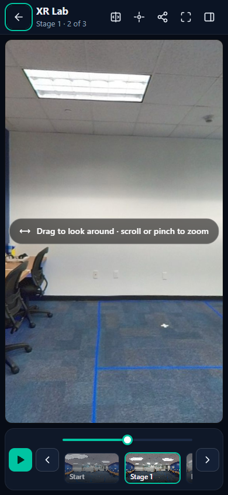
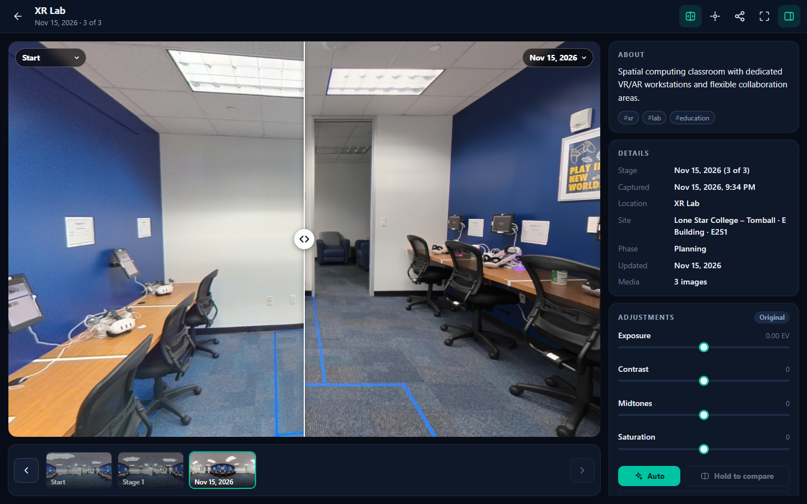

# Using the viewer

Open any project card (or a link like `index.html#/commons`) to enter the 360° viewer.

## Layout

- **Top bar:** back arrow, project title, current stage ("Stage 1 · 2 of 4") and loading progress. On the right: **Sound** (only for projects with video), **Split view**, **Recenter**, **Share**, **Full screen**, and the **Details** panel toggle.
- **View:** the panorama itself. Drag to look around; scroll the mouse wheel or pinch to zoom.
- **Timeline:** the slider cross-fades continuously between stages. Let go and it settles on the nearest stage. **‹ ›** step one stage at a time with a short animated fade. The **filmstrip** below shows every stage; click one to jump to it.
- **Play** (the teal button at the left of the timeline, or **Space**/**P**) plays through the stages in order: Start → Stage 1 → Stage 2 … It dissolves slowly between them (4 s), holds on each one (3 s, shown as a bar filling under the current filmstrip item), and after the last stage fades straight back to Start and keeps looping. You can keep dragging to look around while it plays. Using the slider, ‹ ›, the filmstrip, Home or End stops playback. Stages that are still loading are waited for; stages that failed to load are skipped. Change the timing with `PLAY_FADE_MS` and `PLAY_HOLD_MS` at the top of `viewer.js`.
- **Details panel:** the About, Details, Adjustments and Shortcuts sections. On wide screens it's a sidebar that you can hide. On screens 960 px wide or narrower it slides over the view, and it starts closed.

In **full screen**, the timeline floats over the image so you can keep changing stages.

## Split view

**Split view** (the button with two halves, or **S**) shows two stages side by side, split by a vertical divider. It's the clearest way to compare exactly the same spot before and after.

*If the two sides look at different walls, as here, the camera was turned differently on each visit. Fix it once with [alignment](#editor-for-content-editors).*

- **Drag the divider** (or focus it and use ← →) to move it.
- The labels at the top-left and top-right are menus. Choose which stage is on each side. The right side follows the timeline, so **‹ ›** and the filmstrip change it.
- Looking around moves both sides together, because they're the same view of two panoramas.
- Play and the blend slider are hidden while split view is on. **S** or **Esc** turns it off. Entering VR turns it off too.

## Hotspots

Some projects have **hotspots**: pulsing dots fixed to a point in the panorama. Click one to read its note. If it links to another project, the **Go to …** button opens that project. Hotspots can be shown on every stage or only on one. They're added with the [editor](#editor-for-content-editors).

## Sharing and embedding

The **Share** button offers:

| Option | What you get |
|---|---|
| **Copy link to this view** | A link that opens this project **at the current stage, looking in the current direction**, e.g. `…/#/xr-lab?stage=2&yaw=90&pitch=-5`. |
| **Copy embed code** | An `<iframe>` snippet for another web page (an intranet page, a news post, a slide). |
| **Share…** | Your device's share sheet (phones and some desktop browsers). |

Link parameters, all optional:

| Parameter | Meaning |
|---|---|
| `stage` | Stage number, starting at 1. |
| `yaw` | Horizontal direction in degrees. 0 is the centre of the panorama; positive turns right. |
| `pitch` | Vertical direction in degrees. Positive looks up. |

**Embed mode** (`index.html?embed=1#/<id>`) shows just the viewer: no site header, no close button, and Esc doesn't leave the project. An **Open in Progress360** button opens the full site in a new tab.

## Editor (for content editors)

Add `?edit` to the address to turn on the editor, for example `http://localhost:8080/index.html?edit#/xr-lab`. An **Editor** section appears at the top of the Details panel. Nothing you do here changes files directly. Your edits are kept as a **draft** in this browser (the orange *Draft* badge), and the panel shows the JSON to paste into the project's entry in `assets/projects.json`.

**Align stages.** Panoramas taken months apart are rarely pointed the same way, so a cross-fade can look like the room spins. Go to the later stage, click **Align this stage**, and the previous stage is shown on top at 50%. Turn the **Rotation** slider (or use the −5°/−½°/+½°/+5° buttons) until the walls, windows and doors line up, then click **Done aligning**. Each stage is aligned to the stage before it, so work from the second stage forwards.

**Start view.** Look in the direction visitors should see first and click **Use the current view as the start view**. This also saves the zoom.

**Hotspots.** Point the **centre of the view** at the spot, type a title and an optional description, optionally choose a project to link to, tick **Only on this stage** if it only makes sense on the current stage, then click **Add hotspot at view centre**. Remove one with **×** in the list or **Remove (editor)** in its popup.

**Save.** Click **Copy JSON** and paste the lines into this project's object in `assets/projects.json` (for example after `"folder"`), replacing any `view`, `align` or `hotspots` already there. Then run `npm run check` to make sure everything matches. **Discard draft** throws the draft away. The field formats are described in [adding-projects.md](adding-projects.md#start-view-alignment-and-hotspots).

## Keyboard shortcuts

| Key | Action |
|---|---|
| Space / P | Play / pause through the stages (Space works when no button has focus; P always works) |
| ← / → | Previous / next stage |
| Home / End | First / last stage |
| F | Full screen on/off |
| R | Recenter view: back to the start view, and reset zoom |
| S | Split view on/off |
| + / − | Zoom in / out |
| C (hold) | Show the original, without adjustments |
| I | Show/hide the Details panel |
| M | Sound on/off (video stages) |
| Esc | Close the share menu, stop aligning, leave split view, exit VR, exit full screen, close the slide-over panel (narrow screens), or go back to the gallery, whichever applies first. In embed mode it never leaves the project. |

## Details panel

- **About:** the project description and tags from `projects.json`.
- **Stage:** label and position.
- **Captured:** from the photo's EXIF `DateTimeOriginal`. If the photo has none, it falls back to the file's `Last-Modified` date from the server. Videos show "—".
- **Location:** if the photo has GPS EXIF data, a link to Google Maps; otherwise `meta.location`.
- **Site, Phase, Updated, Media:** from `projects.json` and the stage list.

## Adjustments

Images start **exactly as captured**: with every slider at 0, the screen shows the source pixels unchanged. The adjustments let a viewer compensate for a dark or flat capture without editing files.

| Control | Range | What it does |
|---|---|---|
| **Exposure** | −2 to +2 EV | Brightens or darkens like a camera exposure change, applied in linear light. +1 EV doubles the light. Highlights can clip at high values. |
| **Contrast** | −50 to +50 | Spreads tones away from (or toward) middle grey. |
| **Midtones** | −50 to +50 | Lifts or lowers the middle tones while leaving pure black and white where they are, like the middle slider in a Levels tool. Good for opening up shadows without blowing out windows. |
| **Saturation** | −100 to +100 | −100 is black and white; +100 doubles colour intensity. |

- **Applies to every stage of the project.** Before and after are always shown with the same treatment, so the comparison stays fair.
- **Auto** samples every loaded stage (ignoring the stretched floor and ceiling areas) and suggests an exposure that brings the average to a natural middle grey, plus a small contrast lift if the images are flat. It's deliberately gentle and only runs when you click it.
- **Hold to compare** (or hold **C**) temporarily shows the original.
- **Reset** returns every slider to 0. **Double-click** a single slider to reset just that one.
- The badge next to the heading reads **Original** or **Adjusted**.

Adjustments are stored **in your browser only**. They aren't shared with other visitors and don't change the files.

## What gets remembered

For each project, the browser stores the last stage, view direction, zoom and adjustments in `localStorage`, under the key `p360:v2:<project id>`. It also remembers whether you hid the details sidebar, whether you've seen the "drag to look around" hint, and the gallery's sort, grouping and grid/map choice (`p360:gallery:*`). Editor drafts are stored under `p360:draft:<project id>`.

A share link's `stage`/`yaw`/`pitch` win over what was remembered. A project's start view applies when there's nothing remembered.

To clear it, use your browser's site data settings, or run `localStorage.clear()` in the dev tools console.

> The `v2` prefix was introduced with the colour-pipeline fix. Settings saved by older versions were tuned to compensate for the old too-dark rendering, so they're intentionally ignored.

## Video stages

- Videos loop and start muted, because browsers block autoplay with sound. The **Sound** button pulses gently when the current stage has audio. Click it (or press **M**) to turn sound on.
- Only the current stage's video plays sound. During a cross-fade, both videos involved play.
- Leaving the viewer pauses every video.

## VR (WebXR)

On a headset browser that supports WebXR (e.g. Meta Quest Browser), an **ENTER VR** button appears in the bottom-right corner of the view. The page must be served over **HTTPS**.

| Controller | Action |
|---|---|
| Trigger on the first controller (WebXR controller 0, usually the right hand) | Next stage |
| Trigger on the second controller (controller 1) | Previous stage |
| Squeeze (either) | Exit VR |

Adjustments made before entering VR carry over.

## Phones and slower devices

On screens 900 px wide or narrower, and on GPUs that can't handle textures over 4096 px, the viewer loads the `-4k.jpg` copy of each stage (when there is one) instead of the full 6–8K original. The first stage appears straight away from its small thumbnail and sharpens when the image arrives. Create the copies with `tools/generate-thumbs.ps1` (see [adding-projects.md](adding-projects.md#4-thumbnails-and-4k-copies)).

## Install as an app

Progress360 has a web app manifest, so browsers offer **Install** (desktop Chrome/Edge) or **Add to Home Screen** (phones). The installed app opens full screen, and pages you've already visited open offline.
